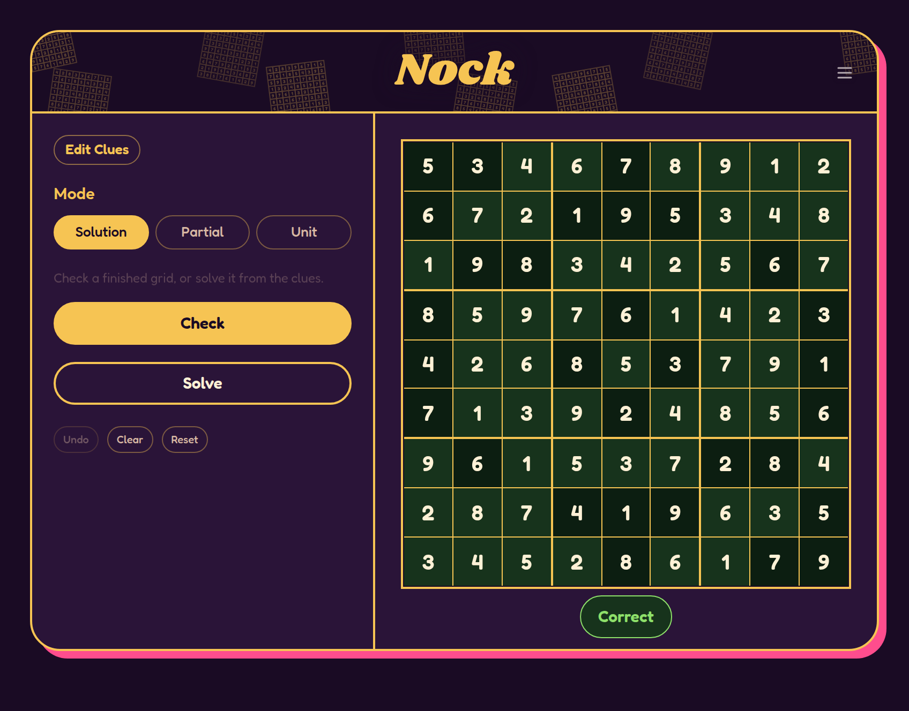
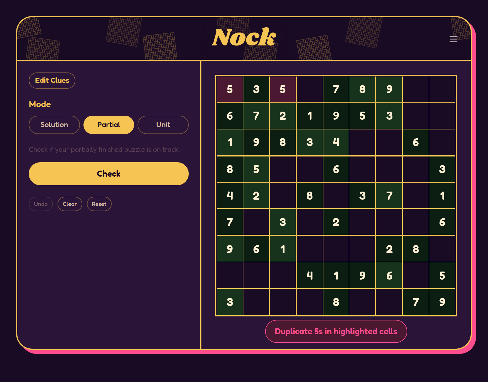
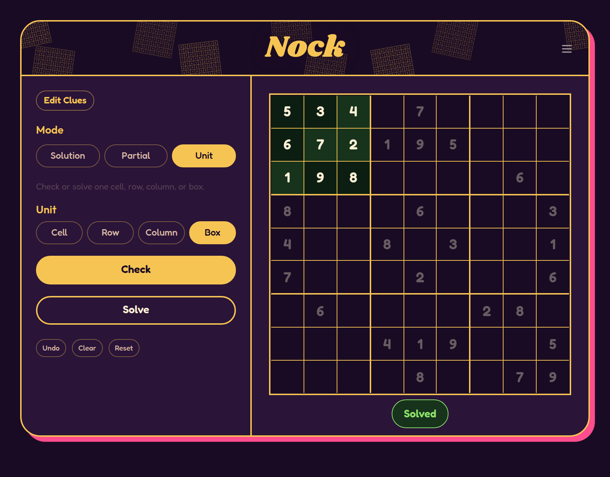

  

<h1 align="center">Nock</h1>

  Check a Sudoku, or solve it, right in your browser.

  

  <a href="https://wyatt-davis.github.io/Nock/"><strong>Open the live app</strong></a>

<table>
  <tr>
    <td></td>
    <td></td>
    <td></td>
  </tr>
  <tr>
    <td align="center">Check the puzzle's full solution.</td>
    <td align="center">Monitor accuracy as you go.</td>
    <td align="center">Solve one unit at a time.</td>
  </tr>
</table>

## Features

- **Solution:** checks the whole grid for duplicates, wrong numbers, and empty cells.
- **Partial:** checks a partially completed grid for duplicates against the clues, ignoring empty cells.
- **Unit:** checks or solves just one cell, row, column or box.
- **Works offline:** the whole app is one page with no sign-in required.

## How to use

### On the website

1. Open [wyatt-davis.github.io/Nock](https://wyatt-davis.github.io/Nock/).
2. Enter the puzzle's given clues.
3. Type your own numbers into the empty cells.
4. Pick Partial, Solution, or Unit.
5. Click Check or Solve.

## Keyboard shortcuts

| Key | Action |
| --- | --- |
| 1–9 | Enter answer |
| Shift+1–9 | Enter clue |
| Backspace | Clear answer / step back |
| Shift+Backspace | Remove clue |
| Space | Next cell / convert in edit |
| ← ↑ → ↓ | Move |
| E | Edit clues |
| D | Done |
| U | Undo |
| C | Clear answers |
| R | Reset board |

## Privacy

Nock runs in your browser. It has no server.

- The board stays in this browser's `localStorage` (`proofgrid-v1`): clues, answers, mode, and the selected unit.
- Check history stays in `proofgrid-history-v1`. A check stores the mode, both grids, the unit, and the message. The list keeps 20.
- The puzzle is not sent anywhere. If storage is blocked, the page still runs and forgets the board when you leave.
